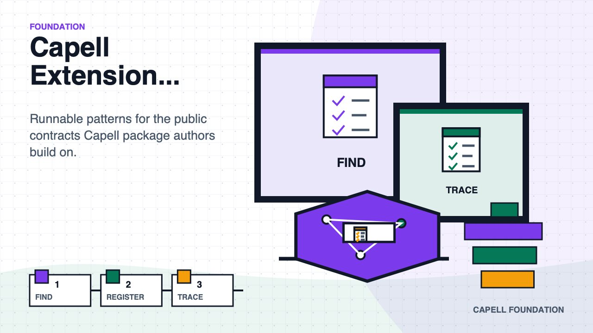

# Capell Extension Cookbook

<!-- prettier-ignore-start -->

## What It Does

Extension Cookbook is a free, runnable package of small examples for Capell's released Core, Admin, Frontend, lifecycle, data, health, and content-graph contracts; experimental seams are called out as follow-up gaps.

- **Price and availability:** Check current availability and price on the [Capell Marketplace listing](https://capell.app/extensions/extension-cookbook).
- **Licence:** Published under MIT in `composer.json`.
- **Requires:** `PHP ^8.4`, `capell-app/admin ^1.0.72`, `capell-app/core ^1.0.75`, `capell-app/frontend ^1.0.72`, `capell-app/layout-builder ^1.0`, `filament/forms ^5.7.6`, `filament/filament ^5.7.6`, `laravel/framework ^12.61.1|^13.12.0`, `lorisleiva/laravel-actions ^2.8`, `spatie/laravel-data ^4.5`, `spatie/laravel-package-tools ^1.14.1`, `spatie/laravel-settings ^3.0`.
- **Install:** `composer require capell-app/extension-cookbook`.

Package authors can install one maintained example, follow each contribution from manifest to provider, and copy the focused test that proves its behaviour.

## Who It Is For

**For developers:** The [contribution map](docs/contribution-map.md) traces each demonstrated seam to its owning class, registration path and focused regression test; deliberately inactive seams are labelled instead of being implied.

**For teams:** The cookbook is MIT-licensed and free to install, so teams can evaluate extension patterns without adopting a commercial feature package or copying undocumented internals.

## Quick Start

1. Install the package: `composer require capell-app/extension-cookbook`.
2. For developers building a Capell extension: Permission to view the Extension Cookbook (the `View:ExtensionCookbook` permission) in a development environment.
3. Open `/admin/extension-cookbook`. Under **System**, open **Capell Extension Cookbook** and read the Extension coverage groups, then the Registrar method coverage section. Each card names a contract and whether the cookbook demonstrates it.
4. Check the result: The page lists every demonstrated contract with its status, so you can pick the first recipe to copy. Next: Open the contribution map in the package docs, find the registrar for that contract in **Which registrar?**, and copy its focused test.

## Configure

- **Configuration files:** `config/extension-cookbook.php`.
- **Admin settings:** `Capell\ExtensionCookbook\Settings\ExtensionCookbookSettings`.
- **Commands:** `php artisan capell:extension-cookbook-doctor`.

## Limits And Pitfalls

- Install the required Capell packages at the versions in `composer.json`: `capell-app/admin ^1.0.72`, `capell-app/core ^1.0.75`, `capell-app/frontend ^1.0.72`, `capell-app/layout-builder ^1.0`.
- Run migrations before opening package resources or public routes.
- Review middleware, throttling, signatures, and public-output safety in `routes/web.php` before exposing routes.
- Keep the host Laravel scheduler running so package-registered schedules can execute: `Capell\ExtensionCookbook\Manifest\Frontend\ExtensionCookbookScheduledJobContribution (manifest declared)`.
- Keep public Blade and cached HTML free of authoring markers, model IDs, permissions, signed editor URLs, and lazy database queries.
- Custom write integrations must preserve invalidation for `extension-cookbook` cache tags.

## Screens And Workflow

- Capell Extension Cookbook in the admin extension catalogue (admin).
- Extension Cookbook widget in Layout Builder (admin).
- Public Capell Extension Cookbook route (frontend).

## Install Impact

- Required packages: `capell-app/admin`, `capell-app/core`, `capell-app/frontend`, `capell-app/layout-builder`.
- Admin navigation: declares `admin-page: ExtensionCookbookAdminPageContribution`, `admin-resource: ReferenceEntryResourceContribution`; each Filament page or resource controls its own navigation visibility.
- Admin/editor extensions: `admin-action-extender: ExtensionCookbookAdminActionExtenderContribution`, `configurator: ExtensionCookbookConfiguratorContribution`, `content-widget: ExtensionCookbookContentWidgetContribution`, `dashboard-widget: ExtensionCookbookDashboardWidgetContribution`, `dashboard-widget: ExtensionCookbookOverviewStatContribution`, `schema-extender: ExtensionCookbookSchemaExtenderContribution`, `workflow-attention: ExtensionCookbookWorkflowAttentionContribution`.
- Permissions: `View:ExtensionCookbook`, `Manage:ExtensionCookbook`; permission contributions: `Capell\ExtensionCookbook\Manifest\Admin\ExtensionCookbookPermissionsContribution`; access also governed by package policies: `ReferenceEntryPolicy`.
- Public routes: loads `routes/web.php`; registers `ExtensionCookbookRoutesContribution`.
- Database changes: package migrations are declared.
- Config: `config/extension-cookbook.php`.
- Settings: `Capell\ExtensionCookbook\Settings\ExtensionCookbookSettings`.
- Queues or schedules: scheduled commands `Capell\ExtensionCookbook\Manifest\Frontend\ExtensionCookbookScheduledJobContribution (manifest declared)`; queue jobs `AuditExtensionCookbookHealthJob`.
- Cache tags: `extension-cookbook`.
- Commands: `capell:extension-cookbook-doctor`.

## Troubleshooting

| Symptom | Likely cause | Check | Fix |
| --- | --- | --- | --- |
| Package health check reports a problem | Package configuration or runtime dependencies are not ready | Run `php artisan capell:extension-cookbook-doctor` | Follow the reported checks, then rerun the doctor command |
| Package surface is missing after install | Provider or manifest is not loaded | Confirm `capell.json`, package `composer.json`, and provider registration | Reinstall the package, refresh Composer autoload, and clear host caches |
| Admin screen or command fails on missing table | Package migrations have not run | Check the tables listed in `Data Model` | Run host migrations and rerun the focused package test |
| Route returns unexpected output | Route cache, middleware, or signed URL setup does not match the package route file | Check the route files listed in `Technical Shape` | Clear route cache and verify middleware before exposing public routes |
| Background work does not run | Queue worker or declared schedule is not active | Check the jobs and scheduled commands listed in `Technical Shape` | Start the queue worker or host scheduler, then run the focused command or package test |
| Public output leaks unexpected state | Render data, cache variation, or authoring boundary has regressed | Check public Blade, cache tags, and public-output safety tests | Move data loading out of Blade and rerun the package public-output tests |

## Upgrading

No manual steps between minor versions.

Read [CHANGELOG.md](CHANGELOG.md) before upgrading.

## Next Steps

- [Package docs](docs/README.md)
- [Overview](docs/overview.md)
- [Worked extension examples](docs/extension-contracts.md)
- Configuration files: [`config/extension-cookbook.php`](config/extension-cookbook.php).
- [Troubleshooting](#troubleshooting)
- [Developer reference](docs/reference.md)
- [Marketplace assets](docs/assets/marketplace/)
- [Capell content language plan](../../docs/CONTENT_LANGUAGE_PLAN.md)
- [Capell documentation design system](../../docs/DESIGN_SYSTEM.md)
- [Capell and package ERD notes](../../docs/erd/capell-and-package-erds.md)
- Related packages: [Layout Builder](../layout-builder/README.md).

<!-- prettier-ignore-end -->
